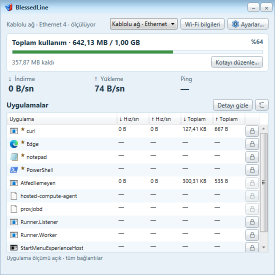
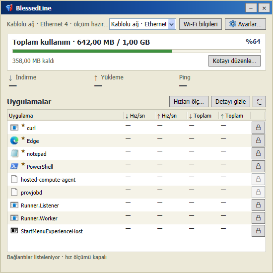
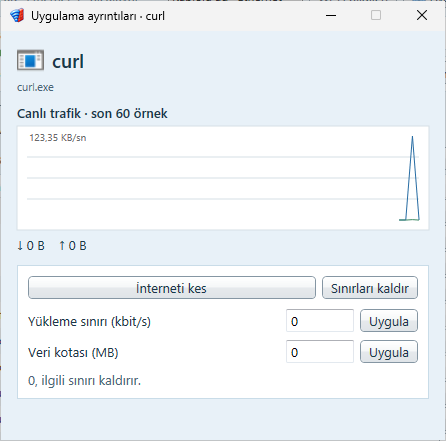
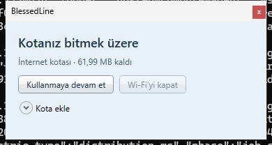
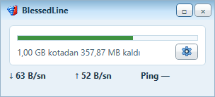

# BlessedLine

BlessedLine, Windows ve Linux için internet kullanımı ve kota sayacıdır. Ana pencere seçili bağlantının hızını ve kotasını, altındaki tablo ise ağ kullanan uygulamaları gösterir.

[English](docs/README.en.md) · [Sürüm notları](https://github.com/ugrqn/Blessed-Line-Net/releases/tag/v0.6.2-preview) · [11 dilli indirme kartları (ZIP)](https://github.com/ugrqn/Blessed-Line-Net/releases/download/v0.6.2-preview/BlessedLine-0.6.2-downloads.zip)

## İndir

| Windows 64 bit | Windows 32 bit | Linux |
| :--- | :--- | :--- |
| **[İndir · x64 .7z](https://github.com/ugrqn/Blessed-Line-Net/releases/download/v0.6.2-preview/BlessedLine-0.6.2-win-x64.7z)** | **[İndir · x86 .7z](https://github.com/ugrqn/Blessed-Line-Net/releases/download/v0.6.2-preview/BlessedLine-0.6.2-win-x86.7z)** | **[İndir · .tar.gz](https://github.com/ugrqn/Blessed-Line-Net/releases/download/v0.6.1-preview/BlessedLine-0.6.1-linux.tar.gz)** |
| Windows 11 / 64 bit Windows 10 | 32 bit Windows 10 | Debian ve Ubuntu önizlemesi |

Windows’ta eski sürüm açıksa bildirim alanındaki simgeden **Çıkış**’ı seç. Yeni arşivi ayıkla ve `BlessedLine.exe` dosyasını aç. İlk açılışta **Windows ile başlat** seçeneği etkindir. Oturum açıldığında sayaç tepside çalışır. Windows’un Başlangıç Uygulamaları listesinde **BlessedLine** adı ve program simgesi kullanılır. Ana pencereyi tepsi simgesinden açabilir, otomatik başlatmayı **Ayarlar** bölümünden kapatabilirsin. Linux paketinde Python 3 ve Tk gerekir. [Linux kullanım bilgileri](src/BlessedLine.Linux/README.md)

## Ekran görüntüleri

| Windows 7 Aero | XP Klasik |
| :---: | :---: |
| [](docs/gallery/aero-dashboard.png) | [](docs/gallery/xp-dashboard.png) |
| Kota, bağlantı hızı ve uygulama trafiği. | Ayarlar’dan seçilebilen klasik görünüm. |

| Uygulama ayrıntıları | Kota uyarısı |
| :---: | :---: |
| [](docs/gallery/application-details.png) | [](docs/gallery/quota-warning.png) |
| Uygulamaya çift tıklayarak canlı grafiği ve sınırları aç. | Kotaya yaklaşınca kalan veriyi gör ve limit ekle. |

**Küçük panel** ekranın köşesinde hızı ve kalan kotayı gösterir.

[](docs/gallery/mini-panel.png)

Görseller, örnek bir sayaçla çalışan Windows sürümünden alınır ve yeni Windows sürümlerinde otomatik yenilenir. [Görsellerin sürümü](docs/gallery/version.txt) · [Galeri iş akışı](.github/workflows/gallery.yml)

## Uygulamalar ve sayaçlar

- **Uygulamalar** açıkken etkin TCP bağlantısı olan programlar otomatik listelenir. Bir programı görmek için o programda bir sayfa aç veya indirme başlat. Windows’un verdiği dosya ya da uygulama paketi simgesi, kısa adın yanında görünür. Simge okunamıyorsa Windows’un genel uygulama simgesi kullanılır.
- Uygulama ölçümü başlangıçta otomatik açılır. Windows yönetici onayı isterse açılan sistem ekranında onayla. **Ayarlar → Ölçümü otomatik başlat** seçeneği başlangıç tercihini kaydeder. Veri kotası olan uygulamalar ölçümü açık tutar. Tabloda her uygulamanın anlık hızlarını ve iki yöndeki toplamını görebilirsin. Çizgi (—) ilk ölçüme kadar görünür.
- Üstteki kota **seçili bağlantıya**, uygulama tablosu Windows’un süreçlere bağlayabildiği **tüm bağlantılardaki TCP ve UDP trafiğine** dayanır. Kaynağı belirlenemeyen trafik “Atfedilemeyen” adıyla gösterilir.
- **Kotayı düzenle…** bölümünde kota ile **Uyarı payı (MB)** birlikte kaydedilir. İlk açılışta toplam kota 1.000 MB, uyarı payı 100 MB’dir. Yeni sayaçların uyarı payı 100 MB’dir. Mevcut sayaçların kaydedilmiş değeri korunur. Erken uyarıyı kapatmak için payı 0 yapabilirsin.
- Uyarı ve kota doldu pencereleri önde açılır. **Kullanmaya devam et**, **Kota ekle** menüsündeki +100, +200, +500 ve +1000 MB seçeneklerinden biri ya da **Wi-Fi’yi kapat** ile işlem yapabilirsin. Pencere açıkken sayaç çalışır.
- **Kota dolunca Wi-Fi’yi kapat** seçeneği kayıtlıysa yeni trafik kotayı geçtiğinde ve cihaz yetkileri izin verdiğinde bu bilgisayarın seçili Wi-Fi radyosu kapanır. Kota dolduktan sonra devam etmek veya yeterli kota eklemek radyoyu açar. Windows eski ağ profilini okumaya izin verdiyse BlessedLine aynı profile bağlanmayı dener.
- **Ayarlar…** içinde **XP Klasik** veya **Windows 7 Aero** görünümünü seçebilirsin. Pencere çerçevesi, yazı tipi ve denetimler temayla birlikte değişir. Ana pencere ve küçük çubuk için uygulama listesini ayrı ayrı açabilirsin. Dili Türkçe ve on ek dil arasından seçebilir, üç uyarı sesini dinleyebilirsin.

## Uygulamaya özel denetimler

- Bir uygulamaya çift tıkla veya satır seçiliyken Enter’a bas. Son 60 örneğin grafiğini, veri kotasını (MB) ve Windows QoS yükleme sınırını (kbit/sn) görebilirsin. Veri kotası ölçülen indirme ve yükleme toplamını sayar, kota dolunca uygulamanın internetini keser. Sayaca uygulama ölçümü açıkken veri eklenir. Windows QoS sınırı yüklemeye uygulanır.
- Satırın sonundaki kilide basarak interneti kes veya geri aç. Üstteki sıfırlama simgesi BlessedLine’ın uygulama kurallarını, veri kotalarını ve QoS ayarlarını kaldırır. Windows yönetici onayı kurallar değişirken gerekebilir. Mevcut yönetici yardımcısı varsa onun yetkileri kullanılır.
- Sağ tık menüsünden uygulamayı favoriye al. Favoriler her sıralamada önce gelir ve açılışlar arasında saklanır.
- **Ayarlar → Trafik renklerini göster** açıkken indirme veya yükleme hızı 100 KB/sn’de sarıya, 1 MB/sn’de kırmızıya geçer.
- Ping, seçili bağlantının **yerel ağ geçidine** ICMP gidiş dönüşünü gösterir. Yanıt yoksa çizgi görünür. **Wi-Fi bilgileri**, bağlı ağın sinyalini, kanalını, bağlantı hızlarını, IP yapılandırmasını ve Windows’un bildirdiği yakındaki ağları tıklayıp kopyalayabileceğin kutularda gösterir. Erişim noktası yayınlarsa ülke kodu ile üretici, model ve cihaz kategorisi de görünür. Ülke kodu telsiz ayarını belirtir. Windows erişim için konum izni isterse panelden ilgili ayarları açabilirsin.

Kurallar EXE yoluna göre uygulanır. Paylaşılan Windows hizmetlerinde ve ayrı EXE kimliği bulunmayan satırlarda ağ müdahalesi kapalıdır. [Doğrulama raporu](docs/dogrulama.md#blessedline-060)

## Küçük çubuk ve bildirim alanı

**–** pencereyi ekranın sağ üstünde küçük çubuğa dönüştürür. Toplam kotayı, kalan miktarı ve iki yöndeki hızı burada görebilirsin. Dişli simgesinden kotayı küçük pencereyi kapatmadan düzenleyebilirsin. **□** ana pencereye döner. **×** pencereyi bildirim alanına gizler ve sayaç çalışmaya devam eder. Saatin yanındaki **∧** altında BlessedLine simgesine çift tıklayarak geri açabilirsin. Tamamen kapatmak için simgeye sağ tıklayıp **Çıkış**’ı seç.

Sayaç ve ayarların konumu `%LOCALAPPDATA%\BlessedLine\state.json` dosyasıdır. Uygulama satırlarındaki toplamlar o ölçüm oturumuna aittir.

## Yerel geliştirme

Windows 11 x64 üzerinde `BlessedLine.slnx` dosyasının bulunduğu klasörü aç. `global.json` .NET SDK 10.0.404 veya aynı özellik bandındaki yeni yamaları seçer.

```powershell
git clone https://github.com/ugrqn/Blessed-Line-Net.git
cd Blessed-Line-Net
dotnet build BlessedLine.slnx -c Release
dotnet test BlessedLine.slnx -c Release --no-build
dotnet run --project src/BlessedLine.Desktop -c Release
```

Taşınabilir yayın üretmek için depo kökünde çalıştır.

```powershell
dotnet publish src/BlessedLine.Desktop -c Release -r win-x64 --self-contained true -o artifacts/win-x64/Desktop
```

Kurucu kaynağı `installer/BlessedLine.iss` dosyasındadır. [Windows kontrol listesi](docs/windows-kontrol.md) önizlemenin yerel ölçüm ve geri alma senaryolarını içerir. [Doğrulama kaydı](docs/dogrulama.md) çalıştırılan testleri, [ilk ürün planı](RetroNet_SOL_PLANI.md) yol haritasını gösterir.

[Uygulama bazlı ağ kuralları araştırması](docs/uygulama-kurallari.md) · [GitHub indirme sayfası kaynakları](site/)
