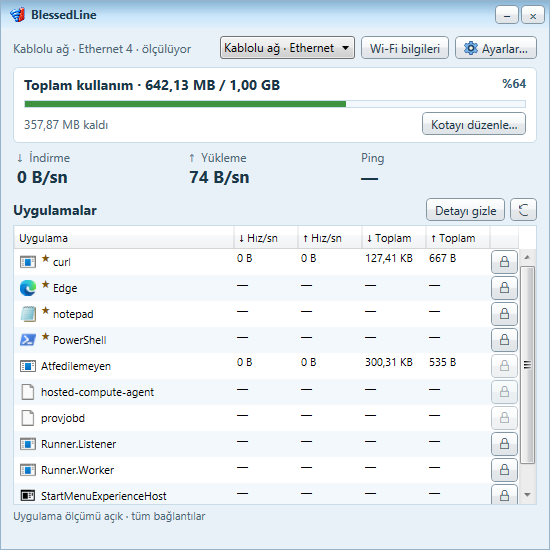
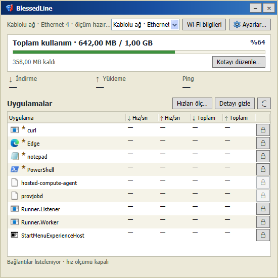
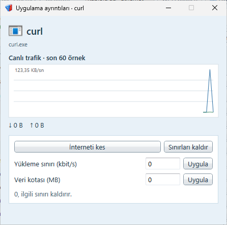
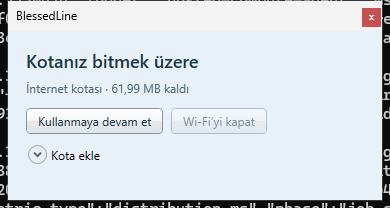
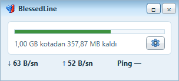

# BlessedLine

[Türkçe](../README.md) · [Release notes](https://github.com/ugrqn/Blessed-Line-Net/releases/tag/v0.6.2-preview)

## Download

| Windows 64-bit | Windows 32-bit | Linux |
| :--- | :--- | :--- |
| **[Download x64](https://github.com/ugrqn/Blessed-Line-Net/releases/download/v0.6.2-preview/BlessedLine-0.6.2-win-x64.7z)** | **[Download x86](https://github.com/ugrqn/Blessed-Line-Net/releases/download/v0.6.2-preview/BlessedLine-0.6.2-win-x86.7z)** | **[Download Linux preview](https://github.com/ugrqn/Blessed-Line-Net/releases/download/v0.6.1-preview/BlessedLine-0.6.1-linux.tar.gz)** |

On Windows, exit the previous version from the notification area, extract the archive and open `BlessedLine.exe`. After the first run, BlessedLine starts in the notification area when you sign in. Disable this from **Start with Windows** in **Settings**. On Debian or Ubuntu, the Linux preview uses Python 3 and Tk. [Linux instructions](../src/BlessedLine.Linux/README.md)

## Screenshots

| Windows 7 Aero | XP Classic |
| :---: | :---: |
|  |  |
| Quota, speeds and per-app traffic. | Classic appearance available in Settings. |

| App details | Quota warning |
| :---: | :---: |
|  |  |
| Double-click an app for its traffic chart and limits. | See remaining data and extend the quota when it runs low. |

The **mini panel** keeps speeds and remaining quota visible in a corner of the screen.

The gallery uses the Windows release with a sample counter and refreshes automatically when a new Windows release is published. [Screenshot version](gallery/version.txt) · [Gallery workflow](../.github/workflows/gallery.yml)

- Track total traffic and the remaining quota on the selected connection. Windows requests per-app measurement at startup. Approve the Windows administrator prompt when required. You can turn measurement off from Settings.
- On Windows, turn on **Turn off Wi-Fi at quota** and approve the administrator prompt. The topmost warning offers a configurable warning threshold, continued use and four quick quota extensions. If the app switched Wi-Fi off, continuing or adding enough quota restores the radio and tries the previous Windows Wi-Fi profile when it is available.
- Use the small window to see the total and remaining quota and edit the limit. Change your language or theme in **Settings**.

[Verification notes](dogrulama.md) · [Download page source](../site/)

- Double-click an application for live traffic, a transfer quota and its Windows QoS upload cap. The row icon toggles Internet access. Right-click to pin favorites and use Settings to toggle traffic colors.
- Ping shows round-trip latency to the selected connection’s local gateway. The Wi-Fi panel shows connection and nearby network details when Windows supplies them.
